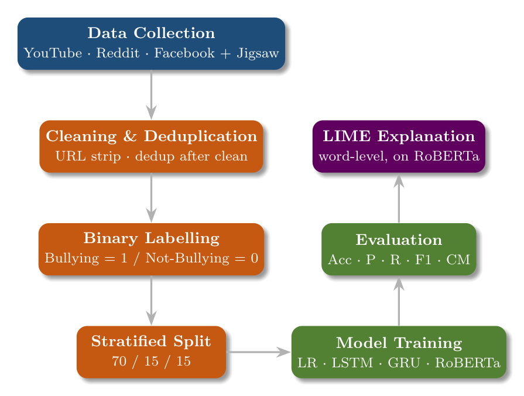
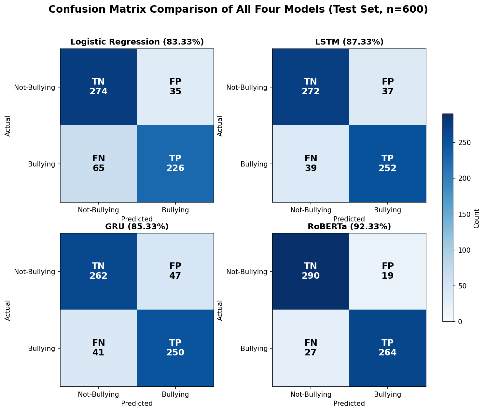
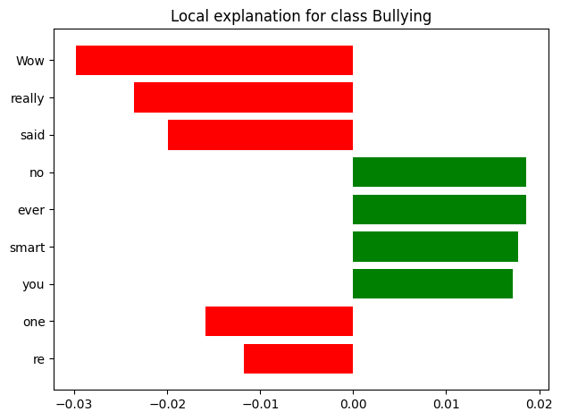

<div align="center">

# Explainable Cyberbullying Detection
### Deep Learning &amp; Transformer Models with LIME

*Detecting online bullying is not enough — a trustworthy system should also explain **why**.*

<br/>


</div>

---

## Overview

Social platforms like **YouTube, Reddit, and Facebook** carry a huge amount of hostile content every day, and manual moderation simply cannot keep up. Most automatic detectors return only a label and give **no reason** for a decision — which makes them hard to trust and hard to defend.

This project builds a cyberbullying detector that is **both accurate and explainable**. We compare four models from a classical baseline up to a fine-tuned transformer, and pair the best one with **LIME** so that every prediction can be traced back to the words that drove it.

> **Base paper extended:** Esan *et al.* (2024) — LSTM, 77.00%, *no explainability*. We improve the accuracy **and** add the missing transparency.

---

## Highlights

- **Fine-tuned RoBERTa reaches 92.33% accuracy** — well above the 77% baseline.
- **LIME word-level explanations** for every prediction — the core novelty.
- **Multi-platform data** (YouTube · Reddit · Facebook) plus the public **Jigsaw** corpus.
- **Cross-dataset validated** — our pipeline beats the base paper *on its own data*.
- **Honest four-way comparison** against a second study — RoBERTa wins every setting.
- **Explainability exposes a real weakness** — a documented sarcasm failure case.

---

## Pipeline

<div align="center">

</div>

Raw comments → **cleaning &amp; deduplication** (dedup *after* cleaning) → **binary labelling** → **stratified 70/15/15 split** → **model training** → **evaluation** → **LIME explanation** on the best model.

---

## Results

<div align="center">

| Model | Accuracy | Precision | Recall | F1 |
|:------|:--------:|:---------:|:------:|:--:|
| Logistic Regression | 83.33 | 83.62 | 83.33 | 83.27 |
| GRU | 85.33 | 85.36 | 85.33 | 85.34 |
| LSTM | 87.33 | 87.33 | 87.33 | 87.33 |
| **RoBERTa (ours)** | **92.33** | **92.36** | **92.33** | **92.33** |

</div>

**Cross-dataset &amp; comparison (RoBERTa):**

| Setting | Accuracy |
|:--|:--:|
| Our data (ours) | **92.33%** |
| Base paper's own Twitter data (46,017) | **89.01%** &nbsp;*(vs their 77.00%)* |
| Base paper (reported LSTM) | 77.00% |
| Second study (reported) | 87.00% |

<div align="center">

<br/><sub>Confusion matrices of all four models on one scale — RoBERTa (bottom-right) has the fewest, best-balanced errors.</sub>
</div>

---

## Explainability with LIME

LIME turns each decision into a readable, word-level explanation — and even surfaces the model's weaknesses.

<div align="center">

<br/><sub>A sarcastic comment wrongly labelled <b>Not-Bullying</b>: positive-sounding words (red) fool the model — invisible in accuracy, obvious with LIME.</sub>
</div>

---

## Repository Structure

```text
.
├── Code/                     # Colab notebook + typeset source code (PDF/LaTeX)
├── Conference Paper/         # IEEE conference paper (.tex + .pdf)
├── Thesis Report/            # Thesis preview, proposal, comparison tables
├── Presentation/             # Defence slides (preview)
├── conf_fig/                 # Figures used by the paper / README
├── IEEEtran.cls              # IEEE paper class
└── README.md
```

> The **raw self-collected dataset is not published** (platform terms &amp; privacy). The supplementary portion comes from the public **Jigsaw Toxic Comment** corpus (CC0).

---

## Reproduce

1. Open `Code/cyberbullyingFinal_binary_only (1).ipynb` in **Google Colab** (GPU runtime).
2. Install dependencies:
   ```bash
   pip install -q transformers datasets lime accelerate scikit-learn tensorflow
   ```
3. Place `CyberBullying Data.csv` next to the notebook and **Run all**.
4. Models train end-to-end (LR · LSTM · GRU · RoBERTa); the final cell runs the **interactive LIME** explainer.

**Key settings:** `roberta-base`, max-len 128, AdamW @ `2e-5`, batch 32, early stopping, seed 42.

---

## Paper &amp; Report

- **Conference paper (IEEE format):** [`Conference Paper/Conference_Paper.pdf`](Conference%20Paper/Conference_Paper.pdf)
- **Thesis preview:** [`Thesis Report/thesis_preview.pdf`](Thesis%20Report/thesis_preview.pdf)
- **Source code (typeset):** [`Code/Thesis_Code.pdf`](Code/Thesis_Code.pdf)

---

## Authors

- **Mohammad Asmual Hoque Yousha**
- **Md Mostafa Kamal Anna**

**Supervisor:** Ms. **Tanni Dhoom**, Assistant Professor
Department of Computer Science and Engineering, Premier University, Chattogram

---

## Citation

```bibtex
@misc{yousha2026cyberbullying,
  title   = {Explainable Cyberbullying Detection Using Deep Learning and Transformer Models with LIME},
  author  = {Yousha, Mohammad Asmual Hoque and Anna, Md Mostafa Kamal},
  school  = {Premier University, Chattogram},
  year    = {2026},
  note    = {BSc Thesis, Department of Computer Science and Engineering}
}
```

---

## Ethics &amp; Responsible Use

This work is intended to **support human moderators**, not replace them. The model has known limits (sarcasm, very short text), so it is best used with a human in the loop. The dataset contains offensive content by nature and is handled for research purposes only.

---

<div align="center">
<sub>Built with RoBERTa + LIME · Accuracy <b>and</b> transparency, not one or the other.</sub>
</div>
